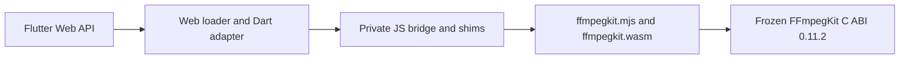

# Flutter Web/Wasm native bridge

This page describes the private browser-to-C bridge used by the Flutter Web package. It covers module loading, C callback and memory ownership, and the pinned runtime boundary. The Phase 2 status and test results live in [the authoritative tracker](../../.agent/PHASE-2-STATUS.md).



## Runtime boundary

Phase 2 pins the local small video/GPL Wasm bundle:

| Artifact | SHA-256 |
| --- | --- |
| `bundle-video-wasm-wasm32-static-small-gpl.zip` | `fd51b8d749040529239fcf992c0f9f348ac07f3c102b4952e0133a42ab5d89fd` |
| `ffmpegkit.wasm` | `7544659af661f4e716c98e28bb5545c9a8da28aba88012f7fd4ed9969ec99e7e` |
| `ffmpegkit.mjs` | `fd21f1a1296790b18f284afa49d878ab730ad3bdd7f7e62dfeef6260ef0ec83b` |

The expected runtime is FFmpegKit `0.11.2`: 527 Wasm exports and 22 verified public mappings. The C ABI, calling conventions, callbacks, session semantics, and public Dart/TypeScript APIs are frozen. The JS bridge checks the runtime version and required exports before handing the module to Dart. Other versions, missing exports, incompatible memory imports, and mismatched Wasm/loader pairs fail initialization.

The bridge and its three private helper modules are maintained in `flutter/web/`, mirrored byte-for-byte in `flutter/assets/wasm/`, and staged by the build hook:

- `ffmpegkit_bridge.mjs`
- `ffmpegkit_loader.mjs`
- `ffmpegkit_callback_runtime.mjs`
- `ffmpegkit_heap_runtime.mjs`

The generated `ffmpegkit.mjs` and `ffmpegkit.wasm` complete the staged runtime pair. The bridge allocates the shared memory required by this pinned artifact (initial 1024 pages, maximum 32768 pages), supplies the loader hooks, creates a module-local canvas for SDL, and installs ffigen JS shims for memory access, strings, and callbacks. The pinned artifact accepted those memory limits; a future artifact must be checked against its actual import contract before changing this setup.

Browser loading requires a secure context with `crossOriginIsolated === true` and `SharedArrayBuffer`. Serve the example with COOP `same-origin` and COEP `require-corp`; cross-origin media must permit CORS/CORP, support byte ranges, and expose `Content-Range`. The SDL canvas belongs to this Emscripten module. It is separate from Flutter's FFplay presentation surface.

## Ownership and execution

Both bridge modules export private protocol version `1`. Their heap, callback and loader helpers are byte-identical. Flutter retains its global factory and ffigen compatibility shims; React Native retains its exported factory and non-recycling callback policy. The parity and bootstrap contracts check these boundaries.

`WasmLoader` owns retryable module initialization. It loads `ffmpegkit_bridge.mjs`, commits the returned module to the generated Dart bindings, then initializes FFmpegKit. `WasmMemory` owns temporary UTF-8 strings, argument vectors, and scratch allocations, freeing them in `finally` paths. C strings returned to Dart are released with `ffmpeg_kit_free` after reading.

`WebCallbackBridge` registers the frozen C callback signatures through the module-local callback registry. It disables C callback registrations when disposed; callback table entries stay owned for the loaded module's lifetime because native work may already have queued a callback. Session and temporary native handles are released after their reads or terminal completion. The heap helper recreates `HEAPU8`, `HEAPU32`, and `HEAPF32` views after Wasm memory growth.

The FFplay frame reader reads metadata first, skips unchanged generations, copies RGBA into an owned Wasm scratch buffer, and releases that buffer and its metadata allocation on dispose. Flutter paints through its own surface. This module canvas and the displayed frame surface have separate lifetimes.

HTTP media input must use asynchronous FFmpeg/FFprobe execution. The native pthread queues Emscripten Fetch work onto the browser's main runtime thread; a synchronous main-thread network open fails with `EPERM`. Phase 2 preserves the frozen C entry points and does not change package-level synchronous-call policy. Network-input rejection, synchronous FFplay removal, and the related public API behavior belong to Phase 3.

Surface transport failures through native logs and the session result/state. Do not use a return code alone as proof of success: FFmpeg can stop an input after a read error without `-xerror`, and the frozen FFmpeg cancellation path can return zero. Cancellation should target the intended session, await its terminal callback/state, and allow the transport to drain its requests. The 1 MiB limit accounts only for accepted HTTP responses and their C copies, not total Wasm memory. Redirected URL-userinfo forwarding is unproven; the runtime also retains its SDL 2.32.8 private-state dependency.

## Local staging

Use the explicit local archive at `\\wsl.localhost\ManyLinux\home\vscode\ffmpeg-kit-builders\prebuilt\wasm-wasm32\releases\bundle-video-wasm-wasm32-static-small-gpl.zip`. Flutter package configuration selects `video`, GPL, `small`, and this `wasm` override. Set `local_only: true` in both `flutter/pubspec.yaml` configuration and the example's `hooks.user_defines.ffmpeg_kit_extended_flutter` entry: Dart Hooks filters arbitrary environment variables, so the typed hook input carries the download prohibition. The hook also accepts `FFMPEG_KIT_EXTENDED_LOCAL_ONLY=1` (or `true`) as a fail-closed guard.

From the repository root, clean both package trees before staging or runtime verification:

```bash
bash flutter/build.sh web --clean
bash react-native/clean.sh
```

Then build Flutter Web from `flutter/example` with the policy set:

```bash
FFMPEG_KIT_EXTENDED_LOCAL_ONLY=1 flutter build web --wasm --release
```

Compare the staged `ffmpegkit.wasm` and `ffmpegkit.mjs` hashes with the table above before running browser cases. Record both clean exit statuses and any `pubspec.lock` diff; `flutter/build.sh --clean` runs `pub upgrade` and can change lockfiles. See [the Phase 2 tracker](../../.agent/PHASE-2-STATUS.md) for current verification status and evidence paths.

## Headless contracts

After cleaning, staging and checking hashes, run `node scripts/wasm-bridge-contract.mjs --full --playback --record bridge-contract.json` from the repository root for direct JS/C contracts. `--rn-adapter` also exercises the TypeScript backend using the example's installed esbuild dependency.

For `--dart-adapter`, build the test entry from `flutter/example`:

```bash
MSYS2_ARG_CONV_EXCL='--base-href=' FFMPEG_KIT_EXTENDED_LOCAL_ONLY=1 \
  flutter build web --wasm --release --no-web-resources-cdn \
  --base-href=/dart/ -t ../test/fixtures/web_native_bridge/main.dart
```

Then run `node scripts/wasm-bridge-contract.mjs --rn-adapter --dart-adapter --record adapter-contract.json` from the repository root. Set `FFMPEG_KIT_BUILDERS_ROOT` to override the default local WSL builders path. The Dart fixture output is test build output; rebuild the normal example before using that output as an application. These fixtures do not measure live native allocator usage or verify public wrapper orchestration.

## Scope

The local `releases/callback-accounting/` pin fixes native Debug callback accounting by preserving balanced enqueue/drain counts throughout execution. `--debug-message-counter` checks FFmpeg, FFprobe and FFplay with live callbacks, nonnegative samples, successful completion, zero drain and handle release. The previous pin returned `-1`; its artifact and failure evidence are preserved. `--callback-order` checks applicable log/statistics/frame-readback/completion ordering. The `--callback-lifetime` contract swaps registrations inside a real running callback, verifies a distinct queued old callback enters after unregistration, then checks replacement delivery, owned-payload lifetime, completion ordering and zero drain before handle release. Event-array order establishes causality even when timer readings are equal; the active callback itself is never counted as the queued old arrival. Callback slots remain retained until module teardown.

The bridge is a private implementation detail. Do not add exports or alter the C ABI, public Dart API, or non-Web native integrations as part of this work. Phase 3 owns public wrapper behavior, example UI, and package-level sync policy. Interactive audible playback is deferred to Phase 3's final manual verification.
