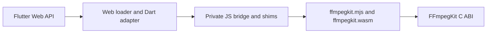

# Flutter Web/Wasm native bridge

This page describes the private browser-to-C bridge used by the Flutter Web package. It covers module loading, C callback and memory ownership, and the runtime boundary.



## Runtime boundary

The bridge and its three private helper modules are maintained in `flutter/web/`, mirrored byte-for-byte in `flutter/assets/wasm/`, and staged by the build hook:

- `ffmpegkit_bridge.mjs`
- `ffmpegkit_loader.mjs`
- `ffmpegkit_callback_runtime.mjs`
- `ffmpegkit_heap_runtime.mjs`

The generated `ffmpegkit.mjs` and `ffmpegkit.wasm` complete the staged runtime pair. The bridge reads the initial and maximum page counts of the module's single imported shared memory from the Wasm binary and allocates a matching shared memory, supplies the loader hooks, creates a module-local canvas for SDL, and installs ffigen JS shims for memory access, strings, and callbacks.

Browser loading requires a secure context with `crossOriginIsolated === true` and `SharedArrayBuffer`. Serve the example with COOP `same-origin` and COEP `require-corp`; cross-origin media must permit CORS/CORP, support byte ranges, and expose `Content-Range`. The SDL canvas belongs to this Emscripten module. It is separate from Flutter's FFplay presentation surface.

## Ownership and execution

Both bridge modules export private protocol version `1`. Their heap, callback and loader helpers are byte-identical. Flutter retains its global factory and ffigen compatibility shims; React Native retains its exported factory and non-recycling callback policy. The parity and bootstrap contracts check these boundaries.

`WasmLoader` owns retryable module initialization. It loads `ffmpegkit_bridge.mjs`, commits the returned module to the generated Dart bindings, then initializes FFmpegKit. `WasmMemory` owns temporary UTF-8 strings, argument vectors, and scratch allocations, freeing them in `finally` paths. C strings returned to Dart are released with `ffmpeg_kit_free` after reading.

`WebCallbackBridge` registers the C callback signatures through the module-local callback registry. It disables C callback registrations when disposed; callback table entries stay owned for the loaded module's lifetime because native work may already have queued a callback. Session and temporary native handles are released after their reads or terminal completion. The heap helper recreates `HEAPU8`, `HEAPU32`, and `HEAPF32` views after Wasm memory growth.

The FFplay frame reader reads metadata first, skips unchanged generations, copies RGBA into an owned Wasm scratch buffer, and releases that buffer and its metadata allocation on dispose. Flutter paints through its own surface. This module canvas and the displayed frame surface have separate lifetimes.

HTTP media input must use asynchronous FFmpeg/FFprobe execution. The native pthread queues Emscripten Fetch work onto the browser's main runtime thread; a synchronous main-thread network open fails with `EPERM`. Phase 2 preserves the C entry points and does not change package-level synchronous-call policy. Phase 3 applies that policy in the Flutter Web backend: synchronous FFmpeg, FFprobe and media-information calls reject direct HTTP(S) input with `UnsupportedError` before any native call, and `FFplaySession.execute()` is deprecated and always throws on every platform. The C entry points are unchanged.

Surface transport failures through native logs and the session result/state. Do not use a return code alone as proof of success: FFmpeg can stop an input after a read error without `-xerror`, and the FFmpeg cancellation path can return zero. Cancellation should target the intended session, await its terminal callback/state, and allow the transport to drain its requests. The 1 MiB limit accounts only for accepted HTTP responses and their C copies, not total Wasm memory. Redirected URL-userinfo forwarding is unproven; the runtime also retains its SDL 2.32.8 private-state dependency.

## Headless contracts

After cleaning, staging and checking hashes, run `node scripts/wasm-bridge-contract.mjs --full --playback --record bridge-contract.json` from the repository root for direct JS/C contracts. `--rn-adapter` also exercises the TypeScript backend using the example's installed esbuild dependency.

For `--dart-adapter`, build the test entry from `flutter/example`:

```bash
MSYS2_ARG_CONV_EXCL='--base-href=' \
  flutter build web --wasm --release --no-web-resources-cdn \
  --base-href=/dart/ -t ../test/fixtures/web_native_bridge/main.dart
```

Then run `node scripts/wasm-bridge-contract.mjs --rn-adapter --dart-adapter --record adapter-contract.json` from the repository root. Set `FFMPEG_KIT_BUILDERS_ROOT` to override the default local WSL builders path. The Dart fixture output is test build output; rebuild the normal example before using that output as an application. These fixtures do not measure live native allocator usage or verify public wrapper orchestration.
