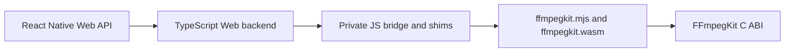

# React Native Web/Wasm native bridge

For the public API support table, direct URL commands, cancellation and bounded
recording/download usage, see [Direct Web media URLs](web-streaming.md).

This page describes the private browser-to-C bridge used by the React Native Web package. It covers module loading, session and callback ownership, heap and frame handling, and the pinned runtime boundary.

## Runtime boundary

`react-native/scripts/prepare-web.js` stages the generated runtime pair together with these four private support modules:

- `ffmpegkit_bridge.mjs`
- `ffmpegkit_loader.mjs`
- `ffmpegkit_callback_runtime.mjs`
- `ffmpegkit_heap_runtime.mjs`

The bridge reads the initial and maximum page counts of the module's single imported shared memory from the Wasm binary and creates a matching shared memory, supplies loader hooks, creates a module-local SDL canvas, and installs ffigen JS shims for heap access, strings, and callbacks.

Browser loading requires a secure context with `crossOriginIsolated === true` and `SharedArrayBuffer`. The example Vite server sends COOP `same-origin` and COEP `require-corp`. Cross-origin media servers must permit CORS/CORP, support byte ranges, and expose `Content-Range`; a missing CORS response is surfaced as a failed session and native diagnostic. The module's SDL canvas is separate from the React view that presents copied FFplay frames.

## Ownership and execution

Both private bridge modules export protocol version `1`; the heap, callback and loader helpers are byte-identical across frameworks. React Native retains its exported factory and non-recycling callback ownership, while Flutter retains its global factory and ffigen compatibility shims. The parity and bootstrap contracts check the shared behavior and these intentional differences.

`initializeWasm` owns the shared initialization promise and resets it after load failure so callers can retry. `WebFFmpegKitBackend` converts strings and argument vectors with temporary Wasm allocations and releases them in `finally` paths. Created session handles are reconciled against the returned native session ID. The session registry retains a handle during asynchronous execution and releases it after terminal monitoring; temporary lookup handles and returned native strings are also released by their owner.

The structured log callback uses the `vjjipp` signature. Its callback slot remains owned for the module lifetime: disabling the C registration prevents new snapshots but does not drain a message already queued by native code. The callback frees each owned native message after copying it to JavaScript. Heap views are refreshed after shared-memory growth. The FFplay reader copies a changed RGBA frame into a JS-owned byte array, frees its temporary C buffer, and uses frame generation and playback epoch to reject stale frames.

HTTP media input must use asynchronous FFmpeg/FFprobe C exports. The native pthread queues Emscripten Fetch work onto the browser's main runtime thread; synchronous main-thread network AVIO fails with `EPERM`. This phase preserves the public APIs and the native ABI. The package-level policy for synchronous Web operations, including removing synchronous FFplay and correcting the `ffplayHasVideoStream` error mapping, belongs to Phase 3.

Phase 3 Web policy: the React Native Web backend exposes no synchronous execute path. `FFplayKit.hasVideoStream` returns `true` only for the C probe value `1`; a missing or unreadable file returns `false`, and a network-scheme URL throws an `Error` that names the async `FFprobeKit.getMediaInformation()` replacement. Direct HTTP(S) playback and recording use the async APIs.

Forward transport failures through native logs and session state. Return code alone is insufficient: FFmpeg may stop reading after an HTTP error without `-xerror`, and cancellation can map to return code zero. Cancel by the target session ID, then wait for terminal settlement and resource cleanup. The 1 MiB transport budget covers accepted HTTP responses plus their C copies, not total Wasm memory. URL-userinfo forwarding through redirects remains unproven, and SDL depends on private state from version 2.32.8.

## Headless contracts

After the clean/stage/hash sequence, run `node scripts/wasm-bridge-contract.mjs --full --playback --rn-adapter --record bridge-contract.json` from the repository root for direct-C and actual TypeScript backend checks. The runner uses the example's existing esbuild dependency and the read-only Phase 1 fixture server. `FFMPEG_KIT_BUILDERS_ROOT` can override its default WSL builders path. The backend fixture tracks handle allocation epochs, including address reuse, and requires exactly one release per allocation plus idempotent repeated release. Native allocator evidence uses the separately authorized diagnostic procedure below.
