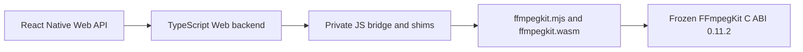

# React Native Web/Wasm native bridge

This page describes the private browser-to-C bridge used by the React Native Web package. It covers module loading, session and callback ownership, heap and frame handling, and the pinned runtime boundary. Phase 2 status and evidence live in [the authoritative tracker](../../.agent/PHASE-2-STATUS.md).



## Runtime boundary

Phase 2 pins the local small video/GPL Wasm bundle:

| Artifact | SHA-256 |
| --- | --- |
| `bundle-video-wasm-wasm32-static-small-gpl.zip` | `fd51b8d749040529239fcf992c0f9f348ac07f3c102b4952e0133a42ab5d89fd` |
| `ffmpegkit.wasm` | `7544659af661f4e716c98e28bb5545c9a8da28aba88012f7fd4ed9969ec99e7e` |
| `ffmpegkit.mjs` | `fd21f1a1296790b18f284afa49d878ab730ad3bdd7f7e62dfeef6260ef0ec83b` |

The expected runtime is FFmpegKit `0.11.2`: 527 Wasm exports and 22 verified public mappings. The C ABI, signatures, callbacks, session semantics, and public Dart/TypeScript APIs are frozen. The JS bridge checks the version and required exports before returning the module. Other versions, missing exports, incompatible memory imports, and mismatched loader/Wasm pairs fail initialization.

`react-native/scripts/prepare-web.js` stages the generated runtime pair together with these four private support modules:

- `ffmpegkit_bridge.mjs`
- `ffmpegkit_loader.mjs`
- `ffmpegkit_callback_runtime.mjs`
- `ffmpegkit_heap_runtime.mjs`

The bridge reads the initial and maximum page counts of the module's single imported shared memory from the Wasm binary and creates a matching shared memory, supplies loader hooks, creates a module-local SDL canvas, and installs ffigen JS shims for heap access, strings, and callbacks.

Browser loading requires a secure context with `crossOriginIsolated === true` and `SharedArrayBuffer`. The example Vite server sends COOP `same-origin` and COEP `require-corp`. Cross-origin media servers must permit CORS/CORP, support byte ranges, and expose `Content-Range`; a missing CORS response is surfaced as a failed session and native diagnostic. The module's SDL canvas is separate from the React view that presents copied FFplay frames.

## Ownership and execution

Both private bridge modules export protocol version `1`; the heap, callback and loader helpers are byte-identical across frameworks. React Native retains its exported factory and non-recycling callback ownership, while Flutter retains its global factory and ffigen compatibility shims. The parity and bootstrap contracts check the shared behavior and these intentional differences.

`initializeWasm` owns the shared initialization promise and resets it after load failure so callers can retry. `WebFFmpegKitBackend` converts strings and argument vectors with temporary Wasm allocations and releases them in `finally` paths. Created session handles are reconciled against the returned native session ID. The session registry retains a handle during asynchronous execution and releases it after terminal monitoring; temporary lookup handles and returned native strings are also released by their owner.

The structured log callback uses the frozen `vjjipp` signature. Its callback slot remains owned for the module lifetime: disabling the C registration prevents new snapshots but does not drain a message already queued by native code. The callback frees each owned native message after copying it to JavaScript. Heap views are refreshed after shared-memory growth. The FFplay reader copies a changed RGBA frame into a JS-owned byte array, frees its temporary C buffer, and uses frame generation and playback epoch to reject stale frames.

HTTP media input must use asynchronous FFmpeg/FFprobe C exports. The native pthread queues Emscripten Fetch work onto the browser's main runtime thread; synchronous main-thread network AVIO fails with `EPERM`. This phase preserves the public APIs and the native ABI. The package-level policy for synchronous Web operations, including removing synchronous FFplay and correcting the `ffplayHasVideoStream` error mapping, belongs to Phase 3.

Forward transport failures through native logs and session state. Return code alone is insufficient: FFmpeg may stop reading after an HTTP error without `-xerror`, and cancellation can map to return code zero. Cancel by the target session ID, then wait for terminal settlement and resource cleanup. The 1 MiB transport budget covers accepted HTTP responses plus their C copies, not total Wasm memory. URL-userinfo forwarding through redirects remains unproven, and SDL depends on private state from version 2.32.8.

## Local staging

Use the explicit local archive at `\\wsl.localhost\ManyLinux\home\vscode\ffmpeg-kit-builders\prebuilt\wasm-wasm32\releases\bundle-video-wasm-wasm32-static-small-gpl.zip`. The example config selects `video`, GPL, `small`, and this `wasm` override. Both artifact-resolution scripts recognize `FFMPEG_KIT_EXTENDED_LOCAL_ONLY=1` (or `true`) and reject default and remote resolution when local-only mode is active.

From the repository root, clean both caches before staging or runtime verification, then rebuild the package and stage the Web example:

```bash
bash flutter/build.sh web --clean
bash react-native/clean.sh
npm --prefix react-native run prepare
FFMPEG_KIT_EXTENDED_LOCAL_ONLY=1 npm --prefix react-native/example run prepare-web
```

The staged root is `react-native/example/public/ffmpeg-kit-extended/wasm/`. It must contain the generated `ffmpegkit.mjs`/`ffmpegkit.wasm` pair plus all four support modules above. Compare both generated file hashes with the table before browser verification. Record the clean exits and any Flutter lockfile diff. See [the Phase 2 tracker](../../.agent/PHASE-2-STATUS.md) for current status and evidence.

## Headless contracts

After the clean/stage/hash sequence, run `node scripts/wasm-bridge-contract.mjs --full --playback --rn-adapter --record bridge-contract.json` from the repository root for direct-C and actual TypeScript backend checks. The runner uses the example's existing esbuild dependency and the read-only Phase 1 fixture server. `FFMPEG_KIT_BUILDERS_ROOT` can override its default WSL builders path. The backend fixture tracks handle allocation epochs, including address reuse, and requires exactly one release per allocation plus idempotent repeated release. Native allocator evidence uses the separately authorized diagnostic procedure below.

## Scope

The local `releases/callback-accounting/` pin fixes native Debug callback accounting by preserving balanced enqueue/drain counts throughout execution. `--debug-message-counter` checks FFmpeg, FFprobe and FFplay with live callbacks, nonnegative samples, successful completion, zero drain and handle release. The previous pin returned `-1`; its artifact and failure evidence are preserved. `--callback-order` checks applicable log/statistics/frame-readback/completion ordering. The `--callback-lifetime` contract swaps registrations inside a real running callback, verifies a distinct queued old callback enters after unregistration, then checks replacement delivery, owned-payload lifetime, completion ordering and zero drain before handle release. Event-array order establishes causality even when timer readings are equal; the active callback itself is never counted as the queued old arrival. Callback slots remain retained until module teardown.

Keep this bridge private. Do not change the C ABI, public TypeScript API, or non-Web native modules. Phase 3 owns public wrapper behavior and example UI. Interactive audible playback is deferred to Phase 3's final manual verification.

Native heap allocation checks use a separately authorized same-source diagnostic build with the existing `ffmpeg_kit_test_http_io_heap_snapshot` hook. After the normal clean/stage sequence, run `node scripts/wasm-bridge-contract.mjs --heap-diagnostic diagnostic-manifest.json --record heap-result.json`. The manifest identifies `same-source-diagnostic-heap-only`, native source commit, local module directory and both SHA-256 values; the runner verifies those files while separately checking that staged production hashes still match the pin. Diagnostic mode cannot be combined with production functional-gate flags.

The heap fixture measures `mallinfo().uordblks`, never linear-memory capacity. It runs three identical warm-ups and ten play/stop cycles, releasing handles/tokens and clearing deliberate native session-history retention before settled samples. Its fixed limits are 64 KiB above baseline and 16 KiB of late-cycle drift; all cleanup and samples are recorded. The production pin has no heap test hook and stays unchanged. This finite native-allocation check does not measure browser/JavaScript heap or prove absence of every possible long-running leak.
